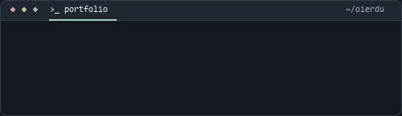
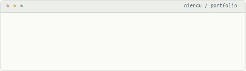
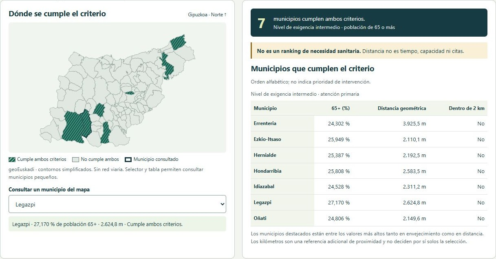
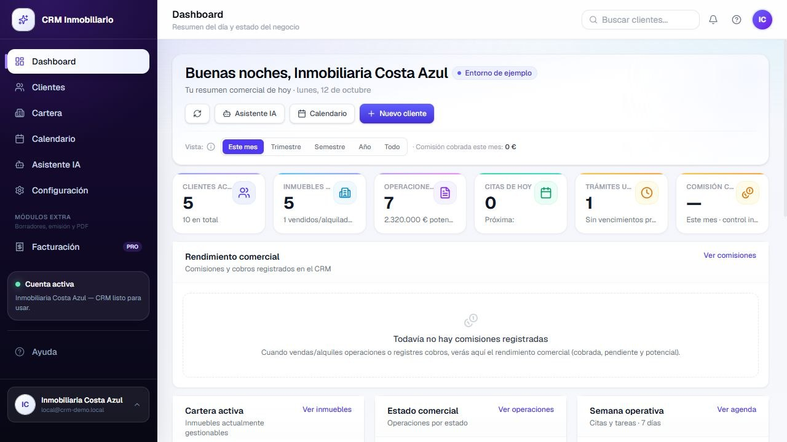

# Oier Duñabeitia Berezo

<strong>Ingeniería Informática — Universidad de Deusto</strong> Desarrollo de software · Web · Software empresarial

Construyo aplicaciones útiles y colaboro en DeustoAI Labs con datos e IA aplicada.

<a href="assets/terminal-compact-dark.gif#gh-dark-mode-only">
<picture>
<source media="(prefers-reduced-motion: reduce) and (max-width: 600px)" srcset="assets/terminal-compact-dark-mobile-still.png" />
<source media="(prefers-reduced-motion: reduce)" srcset="assets/terminal-compact-dark-still.png" />
<source media="(max-width: 600px)" srcset="assets/terminal-compact-dark-mobile.gif" />

</picture>
</a>
<a href="assets/terminal-compact-light.gif#gh-light-mode-only">
<picture>
<source media="(prefers-reduced-motion: reduce) and (max-width: 600px)" srcset="assets/terminal-compact-light-mobile-still.png" />
<source media="(prefers-reduced-motion: reduce)" srcset="assets/terminal-compact-light-still.png" />
<source media="(max-width: 600px)" srcset="assets/terminal-compact-light-mobile.gif" />

</picture>
</a>

<a href="https://raw.githubusercontent.com/oierdu/oierdu/a6cefbb49dc14626c3cb1c124e12f77b43e2fc4c/assets/terminal-compact-dark.gif">Ver animación</a> · <a href="RECURSOS.md">Accesibilidad</a>

## GIPUZKOA 360

### Una consulta breve. Un recorrido que puede ocupar horas.

Llegar a una consulta médica y volver a casa puede ser más complicado que la propia visita. **GIPUZKOA 360**, un proyecto de **DeustoAI Labs**, estudia las diferencias territoriales en el acceso sanitario de los **88 municipios de Gipuzkoa** con datos públicos oficiales, análisis geoespacial y herramientas para agentes de IA.

Permite explorar el mapa, comparar municipios y consultar de dónde sale cada cifra. En los trayectos con datos suficientes, reconstruye escenarios de visita completa —viaje, esperas, paseo, consulta y regreso— con una metodología reproducible y límites explícitos.

> **Seleccionado entre los tres mejores proyectos de más de 60 equipos del Gipuzkoa AI Hackathon 2026.**
>
> Presentación prevista para el **5 de noviembre de 2026 en Tabakalera, Donostia**, en el City Science Summit: encuentro internacional de la red City Science vinculada al MIT Media Lab. [Contexto y fuentes](projects/gipuzkoa360.md#selección-y-contexto-internacional).

Python · pandas · GeoPandas · Eustat · geoEuskadi · Open Data Euskadi

**[Explorar el proyecto →](https://asier-comba.github.io/Guipuzkoa360/)** · [Ficha, metodología y equipo](projects/gipuzkoa360.md)

## Aplicaciones web

### Mateo Von Coach

Producto digital de coaching que guía al visitante desde la explicación del entrenamiento hasta la reserva de una llamada en Calendly. Combina contenido audiovisual, testimonios y acceso a un área de clientes; la navegación organiza un recorrido claro entre conocer el método, resolver dudas y dar el siguiente paso.

React · Vite · Tailwind CSS · Supabase

[Visitar web →](https://mateovoncoach.com/) · [Explorar la ficha](projects/mateo.md)

### Ahorra Aislando

Web empresarial para explicar servicios de aislamiento insuflado, corcho proyectado y tratamientos antihumedad. Presenta la propuesta comercial y el proceso desde el diagnóstico hasta la instalación, con páginas de servicios y vías de contacto para solicitar presupuesto.

React · Vite · Tailwind CSS · Framer Motion

[Visitar web →](https://web-ahorraaislando.vercel.app/) · [Explorar la ficha](projects/ahorra.md)

### Ekin Zentro

Web de un centro de entrenamiento, nutrición y bienestar en Lekeitio. La experiencia bilingüe en castellano y euskera reúne servicios, equipo y un contacto organizado por objetivos y modalidades, además de acceso directo a WhatsApp.

[Visitar web →](https://www.ekinzentroa.com/) · [Explorar la ficha](projects/ekin.md)

### Activa Asesores

Web para un despacho de asesoría en Fuengirola que organiza servicios fiscales, contables, laborales y mercantiles por necesidades de autónomos, empresas y particulares. Incluye páginas por especialidad, información de contacto y una entrada al portal de clientes y asesores.

[Visitar web →](https://proyecto-activa-asesores.vercel.app/) · [Explorar la ficha](projects/activa.md)

## Software empresarial

### CRM inmobiliario con IA

Prototipo de gestión que reúne **clientes, inmuebles, oportunidades y calendario** para seguir la actividad de una inmobiliaria desde una misma aplicación. El dashboard conecta la cartera y el estado comercial con las tareas de la semana; incorpora una interfaz de asistente contextual y módulos de automatización cuyo alcance depende del modo demo y de los servicios configurados.

Next.js · React · TypeScript · Supabase · PostgreSQL · Tailwind CSS

**[Ver demo documentada →](crm-inmobiliario.md)** · Captura sintética auténtica; conexiones externas y alcance del asistente detallados en la ficha.

### CRM Telecomunicaciones

Plataforma de gestión comercial **en desarrollo** para reunir clientes, cartera de servicios, contratos, SIM y equipos. El prototipo organiza estas piezas junto con atención y documentación en una aplicación web modular, con una demo sintética que permite revisar la interfaz sin exponer información de clientes.

Next.js · React · TypeScript · Supabase

[Explorar módulos y estado del prototipo →](projects/crm-telecom.md)

## Stack tecnológico

Herramientas presentes en los proyectos y en mi formación. Java, C/C++ y MySQL forman parte de la base académica; sigo ampliando backend, automatización e IA aplicada.

### Lenguajes y backend

<picture><source media="(max-width: 600px)" srcset="assets/stack-row-1-compact.svg" /></picture>

### Desarrollo web y bases de datos

<picture><source media="(max-width: 600px)" srcset="assets/stack-row-2-compact.svg" /></picture>

### Herramientas, IA y automatización

<picture><source media="(max-width: 600px)" srcset="assets/stack-row-3-compact.svg" /></picture>

## Sobre mí

Estudio Ingeniería Informática en la Universidad de Deusto y disfruto siguiendo el recorrido completo de una aplicación: lo que ve una persona, la lógica que responde y los datos que sostienen el resultado. Desarrollo aplicaciones web y software empresarial, y trabajo con datos en proyectos colaborativos de DeustoAI Labs.

Ahora estoy profundizando en backend y bases de datos, automatización e inteligencia artificial aplicada. Me gusta construir, comprobar lo que funciona y dejar el trabajo lo bastante claro para que otra persona pueda continuarlo. Aprender con un equipo y resolver problemas concretos es la parte que más me engancha del desarrollo.

---

### Hablemos

Busco oportunidades de desarrollo de software compatibles con mis estudios.

oier.dunabeitia@opendeusto.es

