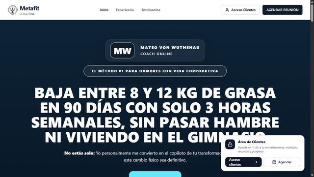
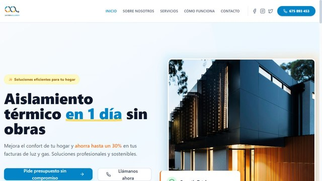
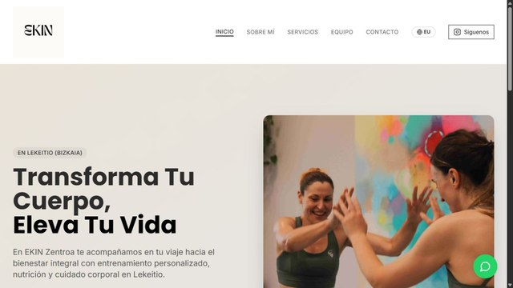
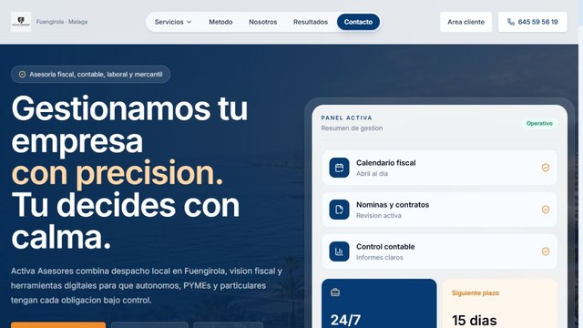
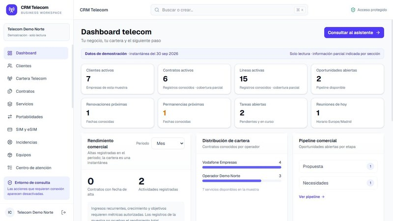
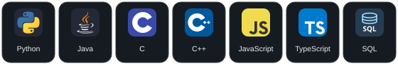
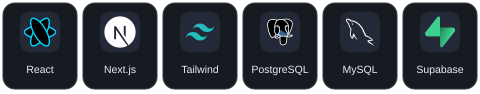
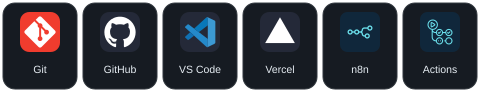

# Oier Duñabeitia Berezo

<strong>Ingeniería Informática — Universidad de Deusto</strong> Desarrollo de software · Web · Software empresarial

Construyo aplicaciones útiles y colaboro en DeustoAI Labs con datos e IA aplicada.

<a href="https://raw.githubusercontent.com/oierdu/oierdu/abccffe0e35853c559ab370f90204a3753833e4f/assets/terminal-compact-dark.gif#gh-dark-mode-only">
<picture>
<source media="(prefers-reduced-motion: reduce) and (max-width: 600px)" srcset="assets/terminal-compact-dark-mobile-still.png" />
<source media="(prefers-reduced-motion: reduce)" srcset="assets/terminal-compact-dark-still.png" />
<source media="(max-width: 600px)" srcset="assets/terminal-compact-dark-mobile.gif" />

</picture>
</a>
<a href="https://raw.githubusercontent.com/oierdu/oierdu/abccffe0e35853c559ab370f90204a3753833e4f/assets/terminal-compact-light.gif#gh-light-mode-only">
<picture>
<source media="(prefers-reduced-motion: reduce) and (max-width: 600px)" srcset="assets/terminal-compact-light-mobile-still.png" />
<source media="(prefers-reduced-motion: reduce)" srcset="assets/terminal-compact-light-still.png" />
<source media="(max-width: 600px)" srcset="assets/terminal-compact-light-mobile.gif" />

</picture>
</a>

## 🏆 GIPUZKOA 360

### Una consulta breve. Un recorrido que puede ocupar horas.

Llegar a una consulta médica y volver a casa puede ser más complicado que la propia visita. En **DeustoAI Labs** desarrollamos **GIPUZKOA 360** para estudiar el acceso sanitario de los **88 municipios de Gipuzkoa** con datos oficiales, análisis geoespacial y herramientas para agentes de IA.

El mapa permite comparar municipios y consultar las fuentes de cada cifra. Donde hay datos suficientes, reconstruye la visita completa: viaje, esperas, paseo, consulta y regreso. La metodología y sus límites están documentados.

> **Seleccionado entre los tres mejores proyectos de más de 60 equipos del Gipuzkoa AI Hackathon 2026.**
>
> Presentación prevista para el **5 de noviembre de 2026 en Tabakalera, Donostia**, en el City Science Summit: encuentro internacional de la red City Science vinculada al MIT Media Lab. [Contexto y fuentes](projects/gipuzkoa360.md#selección-y-contexto-internacional).

Python · pandas · GeoPandas · Eustat · geoEuskadi · Open Data Euskadi

**[Explorar el proyecto →](https://asier-comba.github.io/Guipuzkoa360/)** · [Ficha, metodología y equipo](projects/gipuzkoa360.md)

## 🚀 Aplicaciones web

Proyectos colaborativos. Las fichas recogen el alcance, el estado y los créditos.

### Mateo Von Coach

Coaching online: vídeo, testimonios y reserva de llamadas en Calendly. Un recorrido claro desde conocer el método hasta contactar, con acceso al área de clientes.

React · Vite · Tailwind CSS · Supabase

**[Visitar web ↗](https://mateovoncoach.com/)** · [Ficha y créditos](projects/mateo.md)

### Ahorra Aislando

Servicios de aislamiento insuflado, corcho proyectado y tratamientos antihumedad. Presenta el proceso de trabajo y facilita la solicitud de presupuesto.

React · Vite · Tailwind CSS · Framer Motion

**[Visitar web ↗](https://web-ahorraaislando.vercel.app/)** · [Ficha y créditos](projects/ahorra.md)

### Ekin Zentro

Entrenamiento, nutrición y bienestar en Lekeitio. Web en castellano y euskera con servicios, equipo y contacto por objetivos y modalidades.

**[Visitar web ↗](https://www.ekinzentroa.com/)** · [Ficha y créditos](projects/ekin.md)

### Activa Asesores

Asesoría fiscal, contable, laboral y mercantil en Fuengirola. Servicios por tipo de cliente, contacto y entrada al portal de clientes y asesores.

**[Visitar web ↗](https://proyecto-activa-asesores.vercel.app/)** · [Ficha y créditos](projects/activa.md)

## 💻 Software empresarial

### CRM inmobiliario con IA

Prototipo que reúne **clientes, inmuebles, oportunidades y calendario** en una misma aplicación. El dashboard conecta la cartera comercial con las tareas de la semana; incluye una interfaz de asistente y módulos de automatización dependientes de los servicios configurados.

Next.js · React · TypeScript · Supabase · PostgreSQL · Tailwind CSS

**[Ver demo documentada →](crm-inmobiliario.md)** · Captura sintética auténtica; conexiones externas y alcance del asistente detallados en la ficha.

### CRM Telecomunicaciones · en desarrollo

Plataforma modular para **clientes, servicios, contratos, SIM y equipos**, con módulos de atención y documentación. La demo utiliza datos sintéticos para revisar la interfaz sin exponer información de clientes.

Next.js · React · TypeScript · Supabase

**[Ver prototipo y módulos →](projects/crm-telecom.md)** · Captura de la demo sintética; producto en desarrollo.

## 🧰 Stack tecnológico

Tecnologías de mis proyectos y formación. Java, C/C++ y MySQL forman parte de mi base académica.

### Lenguajes y backend

<picture><source media="(max-width: 600px)" srcset="assets/stack-premium-1-mobile.svg" /></picture>

### Desarrollo web y bases de datos

<picture><source media="(max-width: 600px)" srcset="assets/stack-premium-2-mobile.svg" /></picture>

### Herramientas, IA y automatización

<picture><source media="(max-width: 600px)" srcset="assets/stack-premium-3-mobile.svg" /></picture>

## 👨‍💻 Sobre mí

Estudio Ingeniería Informática en la Universidad de Deusto. Me interesa cómo encajan las piezas de una aplicación: la interfaz, la lógica y los datos. Construyo webs y software empresarial, y colaboro en DeustoAI Labs con datos e IA aplicada.

Ahora estoy profundizando en backend, bases de datos y automatización. Disfruto aprendiendo con un equipo, probando ideas en aplicaciones reales y dejando el trabajo claro para que otra persona pueda continuarlo.

---

### 🤝 Hablemos

Busco oportunidades de desarrollo de software compatibles con mis estudios.

oier.dunabeitia@opendeusto.es

