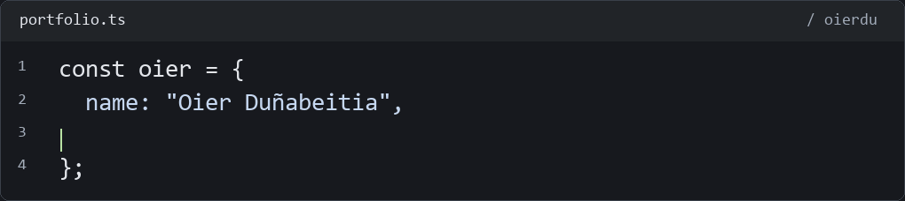

<h2> Oier Duñabeitia Berezo</h2>

**Ingeniería Informática · Desarrollo de software · Datos e IA aplicada**

[LinkedIn](https://www.linkedin.com/in/oier-du%C3%B1abeitia-a64804362/) · [Contacto](mailto:oier.dunabeitia@opendeusto.es) · [Código académico](https://github.com/oierdu/AutoDeusto_ProyectoProgIV_Grupos2)

<picture>
<source media="(prefers-reduced-motion: reduce) and (max-width: 600px)" srcset="assets/editor-dark-mobile-still.svg" />
<source media="(prefers-reduced-motion: reduce)" srcset="assets/editor-dark-still.svg" />
<source media="(max-width: 600px)" srcset="assets/editor-dark-mobile.gif" />

</picture>

Estudio **Ingeniería Informática en Deusto** y he completado el Máster de IA de BIG School. Desarrollo interfaces web, integraciones y automatizaciones. En **DeustoAI Labs** trabajo con datos públicos, análisis geográfico y reproducibilidad. Me interesa construir software que se pueda entender, ejecutar y comprobar.

## Proyecto destacado

### GIPUZKOA 360 · Datos para entender el territorio

Exploración del acceso sanitario en **88 municipios de Gipuzkoa** y escenarios de visita completa en trayectos con datos suficientes: viaje, esperas, paseo, consulta y regreso.

**Mi aportación:** ingesta de fuentes oficiales, análisis geoespacial, calidad y reproducibilidad. Proyecto de **DeustoAI Labs**, junto a **Asier Comba y Hugo Fernández Díez**.

**Top 3 entre más de 60 equipos**, según comunicación de la organización al equipo del Urban Challenge 2026.

**Python · pandas · GeoPandas · datos públicos · herramientas para agentes**

[Explorar la demo](https://asier-comba.github.io/Guipuzkoa360/) · [Metodología y contribuciones](projects/gipuzkoa360.md)

Qué demuestra y cuáles son sus límites

La demo territorial utiliza cálculos guardados y reproducibles, sin conversación en vivo. El análisis de visita sanitaria utiliza horarios programados y paseo modelado en trayectos y fechas concretos; no acredita tiempos reales desde casa, citas disponibles ni capacidad asistencial. Los escenarios no son resultados observados de usuarios.

[Fuentes y metodología originales](https://github.com/Asier-Comba/Guipuzkoa360) · [Créditos del equipo](https://github.com/Asier-Comba/Guipuzkoa360/blob/main/docs/TEAM.md)

## Software y producto

### CRM inmobiliario · Interfaz, datos y operaciones

Prototipo de gestión de clientes, inmuebles, oportunidades y calendario, con asistente e integraciones que requieren configuración. **Next.js · TypeScript · Supabase**.

*Captura de la aplicación real en modo demo, con datos de ejemplo. No representa actividad comercial ni integraciones externas verificadas.*

[Ficha técnica](crm-inmobiliario.md)

### CRM Telecomunicaciones · Desarrollo colaborativo

Participación en un producto web **en desarrollo**, sobre Next.js, TypeScript y Supabase. La aplicación y sus integraciones se encuentran en evolución; no se presenta como SaaS comercial lanzado.

[Estado del proyecto y procedencia](projects/crm-telecom.md)

### Mateo Von Coach · Plataforma de coaching

Desarrollo en colaboración de una web de servicios, contenidos y reserva de llamadas, con rutas de acceso a clientes. **React · Vite · Tailwind CSS · Supabase**.

[Ver web](https://mateovoncoach.com/) · [Desarrollo y alcance](projects/mateo.md)

### Ahorra Aislando · Web de servicios

Desarrollo en colaboración de una web de aislamiento térmico: servicios, proceso y contacto. **React · Vite · Tailwind CSS · Framer Motion**.

[Ver web](https://web-ahorraaislando.vercel.app/) · [Desarrollo y alcance](projects/ahorra.md)

### Más proyectos

- **Ekin Zentro:** web de entrenamiento, nutrición y bienestar. [Ver web](https://www.ekinzentroa.com/).
- **Activa Asesores:** web de asesoría, servicios y contacto. [Ver web](https://proyecto-activa-asesores.vercel.app/).
- **AutoDeusto:** repositorio académico en fase inicial; actualmente contiene una prueba de consola en C. [Código e historial](https://github.com/oierdu/AutoDeusto_ProyectoProgIV_Grupos2).

## Herramientas y fundamentos

Conocimientos académicos y práctica en proyectos; continúo ampliándolos con aprendizaje autónomo.

**Lenguajes** 
    
Python · Java · C · C++ · JavaScript · TypeScript · SQL

**Interfaces web** 
    
React · Next.js · HTML · CSS · Tailwind CSS

**Datos e integración** 
    
PostgreSQL · MySQL · Supabase · APIs · automatización e IA aplicada

**Desarrollo y entrega** 
  
Git · documentación · pruebas · GitHub Actions · Vercel · VPS

## Cómo trabajo

Parto del problema y de los datos disponibles. Documento las decisiones, mantengo la autoría de los proyectos compartidos y distingo lo que está probado de lo que requiere configuración. En GIPUZKOA 360, esto se concreta en fuentes trazables, contratos de datos y cálculos reproducibles.

## Hablemos

Busco oportunidades de **desarrollo de software, backend e IA aplicada compatibles con mis estudios**.

[LinkedIn](https://www.linkedin.com/in/oier-du%C3%B1abeitia-a64804362/) · [oier.dunabeitia@opendeusto.es](mailto:oier.dunabeitia@opendeusto.es) · [GitHub](https://github.com/oierdu)
