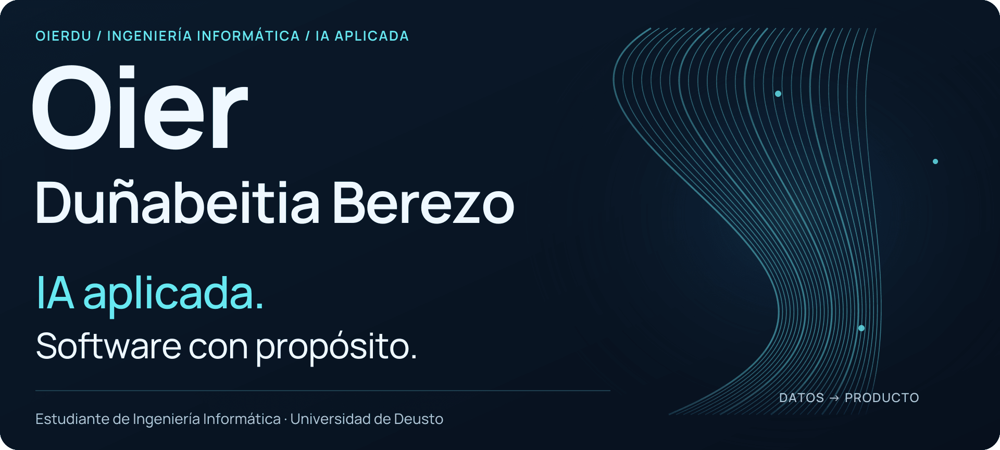
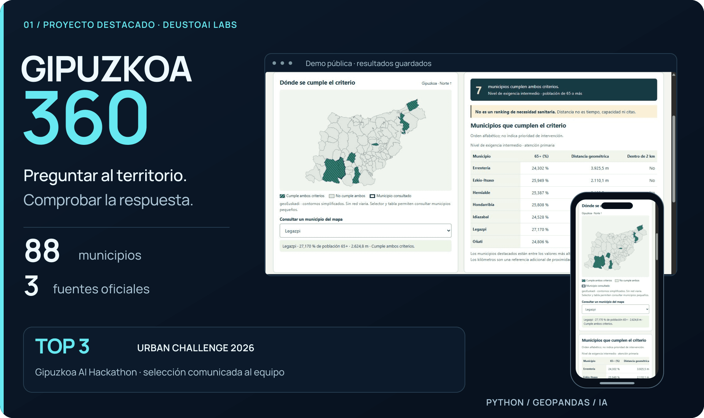
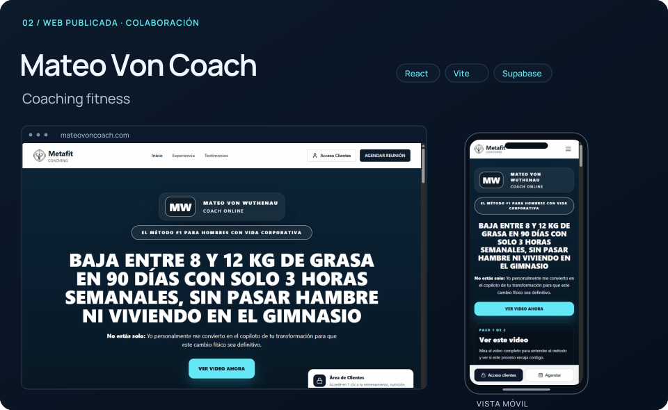
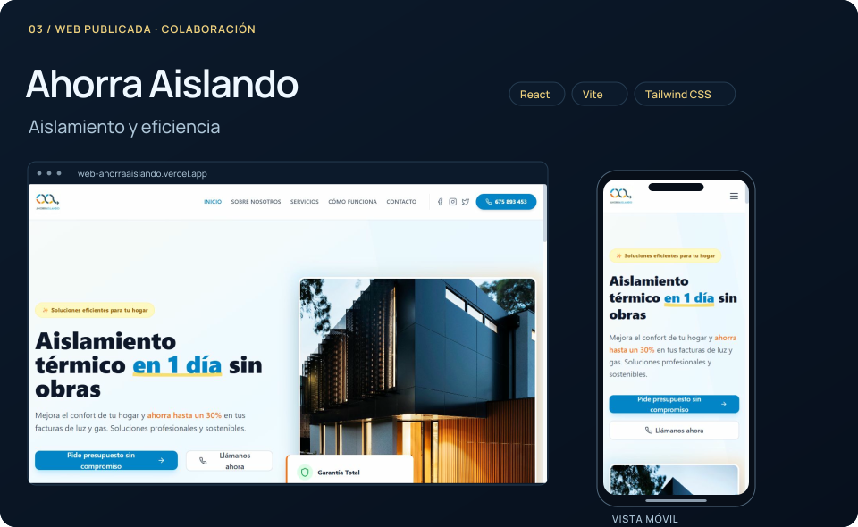
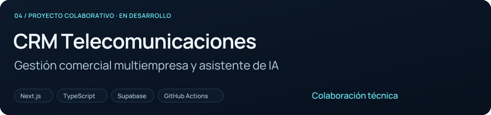
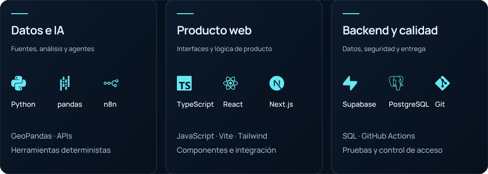

<picture><source media="(max-width: 640px) and (prefers-color-scheme: light)" srcset="hero-mobile-light-still.png" /><source media="(max-width: 640px)" srcset="hero-mobile-still.png" /><source media="(prefers-color-scheme: light)" srcset="hero-light-still.png" /></picture>

<a href="#user-content-gipuzkoa360">GIPUZKOA 360</a> · <a href="#user-content-proyectos">Proyectos</a> · <a href="#user-content-tecnologias">Stack</a> · <a href="#user-content-contacto">Contacto</a>

Soy <strong>Oier Duñabeitia Berezo</strong>, estudiante de <strong>Ingeniería Informática en Deusto</strong>, con formación adicional en IA. Desarrollo proyectos de <strong>IA aplicada, automatización y web</strong>, en equipo y para clientes. Me interesa que una interfaz útil tenga detrás datos fiables y una lógica que pueda comprobarse.

<h2 id="gipuzkoa360">GIPUZKOA 360</h2>

<a href="https://asier-comba.github.io/Guipuzkoa360/"><picture><source media="(max-width: 640px) and (prefers-color-scheme: light)" srcset="gipuzkoa360-mobile-light-still.png" /><source media="(max-width: 640px)" srcset="gipuzkoa360-mobile-still.png" /><source media="(prefers-color-scheme: light)" srcset="gipuzkoa360-light-still.png" /></picture></a>

<strong>IA y datos públicos para investigar el acceso sanitario y la movilidad en Gipuzkoa.</strong> Proyecto de DeustoAI Labs desarrollado con Asier Comba y Hugo Fernández Díez.

<strong>Mi contribución:</strong> ingesta de fuentes oficiales, pipeline geoespacial, controles de calidad, reproducibilidad e integración.

<strong>Top 3 del Urban Challenge, entre más de 60 equipos</strong>, según la comunicación de la organización al equipo. Final presencial: <strong>17 de octubre de 2026</strong>. Presentación prevista: <strong>5 de noviembre</strong>, City Science Summit, Tabakalera.

<a href="https://asier-comba.github.io/Guipuzkoa360/">Abrir demo pública ↗</a> · <a href="https://github.com/Asier-Comba/Guipuzkoa360">Repositorio</a> · <a href="https://github.com/Asier-Comba/Guipuzkoa360/blob/main/docs/TEAM.md">Equipo y contribuciones</a>

<strong>Arquitectura, fuentes y alcance</strong>

<strong>Python · pandas · GeoPandas · herramientas deterministas · agente con herramientas · visualización web.</strong> Fuentes: Eustat, geoEuskadi y Open Data Euskadi. La demo pública muestra resultados guardados y reproducibles.

El análisis diferencia distancia geométrica, tiempos programados y escenarios. No acredita capacidad sanitaria ni disponibilidad de citas. Los datos proceden de fechas distintas.

<a href="https://github.com/Asier-Comba/Guipuzkoa360/blob/main/docs/DEMO.md">Guía de demostración</a> · <a href="https://gipuzkoa-ai-hackathon.com/">Hackathon</a>

<h2 id="proyectos">Proyectos seleccionados</h2>

Desarrollados en colaboración. Los enlaces conservan los repositorios originales y la autoría del equipo.

<a href="https://mateovoncoach.com/"><picture><source media="(max-width: 640px) and (prefers-color-scheme: light)" srcset="mateo-mobile-light.svg" /><source media="(max-width: 640px)" srcset="mateo-mobile.svg" /><source media="(prefers-color-scheme: light)" srcset="mateo-light.svg" /></picture></a>

<strong>Web y plataforma de coaching fitness.</strong> La web pública presenta servicios, testimonios y reserva de llamadas. El repositorio incluye autenticación, entrenamiento, nutrición, progreso y área del coach.

<strong>React · Vite · Tailwind CSS · Supabase</strong> <a href="https://mateovoncoach.com/">Abrir web ↗</a> · <a href="https://github.com/Asier-Comba/Appweb-MateoVonCoach">Repositorio original</a>

<a href="https://web-ahorraaislando.vercel.app/"><picture><source media="(max-width: 640px) and (prefers-color-scheme: light)" srcset="ahorra-mobile-light.svg" /><source media="(max-width: 640px)" srcset="ahorra-mobile.svg" /><source media="(prefers-color-scheme: light)" srcset="ahorra-light.svg" /></picture></a>

<strong>Web corporativa de aislamiento y eficiencia energética.</strong> Servicios, proceso de trabajo, contacto y páginas legales. El formulario prepara un correo en el gestor del visitante.

<strong>React · Vite · Tailwind CSS · Framer Motion</strong> <a href="https://web-ahorraaislando.vercel.app/">Abrir web ↗</a> · <a href="https://github.com/Asier-Comba/web-ahorraaislando">Repositorio original</a>

<a href="https://github.com/Asier-Comba/CRM-Telecomunicaciones"><picture><source media="(max-width: 640px) and (prefers-color-scheme: light)" srcset="telecom-mobile-light.svg" /><source media="(max-width: 640px)" srcset="telecom-mobile.svg" /><source media="(prefers-color-scheme: light)" srcset="telecom-light.svg" /></picture></a>

Gestión comercial multiempresa, cartera telecom, oportunidades, calendario y asistente. <strong>En desarrollo</strong>, con integración y aceptación pendientes.

Participación en el desarrollo de un producto web colaborativo. El proyecto sigue en desarrollo y no se presenta como un servicio comercial lanzado. <a href="https://github.com/Asier-Comba/CRM-Telecomunicaciones">Repositorio público original</a>.

<h3>Otros proyectos web</h3>

<a href="https://www.ekinzentroa.com/">Ekin Zentroa</a>: web corporativa para entrenamiento, nutrición y bienestar en Lekeitio. <a href="https://proyecto-activa-asesores.vercel.app/">Activa Asesores</a>: presentación de servicios y contacto. Proyectos de desarrollo web incluidos en mi experiencia.

<h3>CRM inmobiliario con IA</h3>

Prototipo de CRM y asistente con clientes, propiedades, oportunidades y calendario. Arquitectura documentada: <strong>Next.js, TypeScript, Supabase, OpenAI y n8n</strong>. Las conexiones reales dependen de su configuración. <a href="crm-inmobiliario.md">Ficha técnica</a>.

<strong>AutoDeusto · proyecto universitario en fase inicial</strong>

Proyecto de Programación IV orientado a la gestión de un concesionario mediante arquitectura cliente-servidor en C. El repositorio contiene documentación inicial y un programa de prueba; la implementación funcional y las instrucciones de compilación están pendientes.

<a href="https://github.com/oierdu/AutoDeusto_ProyectoProgIV_Grupos2">Ver repositorio</a>

<h2 id="tecnologias">Del dato al producto</h2>

<picture><source media="(max-width: 640px) and (prefers-color-scheme: light)" srcset="stack-mobile-light.svg" /><source media="(max-width: 640px)" srcset="stack-mobile.svg" /><source media="(prefers-color-scheme: light)" srcset="stack-light.svg" /></picture>

<strong>Stack, formación y tecnologías que estoy explorando</strong>

<strong>En los proyectos presentados</strong>

<ul><li><strong>Datos e IA:</strong> Python, pandas, GeoPandas, APIs, herramientas de análisis y agentes.</li><li><strong>Web:</strong> JavaScript, TypeScript, React, Next.js, Vite, Tailwind CSS y Framer Motion.</li><li><strong>Backend e integraciones:</strong> SQL, PostgreSQL/Supabase, OpenAI y n8n.</li><li><strong>Calidad y entrega:</strong> Git, GitHub Actions, pruebas automatizadas y controles de seguridad.</li></ul>

<strong>Formación y práctica adicional:</strong> Java, C, C++, Make, Vercel, VPS, prompting y automatización.

<strong>Profundizando actualmente:</strong> fundamentos de machine learning, modelos de lenguaje, RAG y agentes con herramientas y supervisión humana.

<h2>Forma de trabajar</h2>

Parto del problema y del alcance, preparo datos y conexiones que puedan comprobarse y documento los límites del resultado. En equipo cuido la reproducibilidad, las pruebas y la integración para que el trabajo sea útil y mantenible.

<h2 id="contacto">Construyamos algo útil</h2>

Busco oportunidades de <strong>IA y software compatibles con mis estudios</strong>. Me interesa trabajar con equipos que cuidan el producto, la calidad técnica y la colaboración.

<a href="https://www.linkedin.com/in/oier-du%C3%B1abeitia-a64804362/">LinkedIn ↗</a> · <a href="mailto:oier.dunabeitia@opendeusto.es">oier.dunabeitia@opendeusto.es</a> · <a href="https://github.com/oierdu">GitHub</a>

