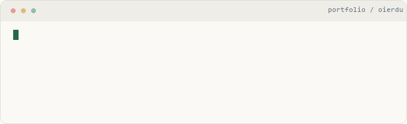

# Oier Duñabeitia Berezo

### Ingeniería Informática · Universidad de Deusto

**Desarrollo de software · Backend · Aplicaciones web · IA aplicada**

Me gusta entender cómo funciona el software y construir aplicaciones que conectan interfaces, lógica y datos. En DeustoAI Labs y en proyectos colaborativos convierto ideas en herramientas que se pueden explorar, ejecutar y mejorar.

<picture>
<source media="(prefers-reduced-motion: reduce) and (prefers-color-scheme: dark) and (max-width: 600px)" srcset="assets/terminal-dark-mobile-still.png" />
<source media="(prefers-reduced-motion: reduce) and (prefers-color-scheme: dark)" srcset="assets/terminal-dark-still.png" />
<source media="(prefers-reduced-motion: reduce) and (max-width: 600px)" srcset="assets/terminal-light-mobile-still.png" />
<source media="(prefers-reduced-motion: reduce)" srcset="assets/terminal-light-still.png" />
<source media="(prefers-color-scheme: dark) and (max-width: 600px)" srcset="assets/terminal-dark-mobile.gif" />
<source media="(prefers-color-scheme: dark)" srcset="assets/terminal-dark.gif" />
<source media="(max-width: 600px)" srcset="assets/terminal-light-mobile.gif" />

</picture>

<a href="assets/terminal-dark.gif?raw=1">Ver la animación de terminal</a> · Secuencia decorativa, con alternativa estática para movimiento reducido.

---

## Stack tecnológico

Práctica en proyectos, fundamentos académicos y aprendizaje continuo. Cada categoría refleja su alcance; no implica experiencia profesional avanzada en todas las herramientas.

<h3 align="center">Lenguajes y sistemas</h3>

<picture><source media="(max-width: 600px)" srcset="assets/stack-row-1-mobile.svg" /></picture>

Python · Java · C · C++ · JavaScript · TypeScript · SQL Python, JavaScript y TypeScript en proyectos; Java, C, C++ y SQL como fundamentos en formación.

<h3 align="center">Frontend</h3>

<picture><source media="(max-width: 600px)" srcset="assets/stack-row-2-mobile.svg" /></picture>

HTML5 · CSS3 · React · Next.js · Vite · Tailwind CSS Interfaces web presentes en los proyectos colaborativos.

<h3 align="center">Backend y bases de datos</h3>

  

PostgreSQL · MySQL · Supabase · APIs Supabase en los proyectos web; fundamentos de datos y consultas SQL. Las integraciones externas requieren configuración y validación independiente.

<h3 align="center">IA y automatización</h3>

n8n · integración de modelos · herramientas para agentes Python aplicado a datos territoriales; ampliando automatización e integración de IA.

<h3 align="center">Herramientas de desarrollo</h3>

<picture><source media="(max-width: 600px)" srcset="assets/stack-row-3-mobile.svg" /></picture>

Git · GitHub · VS Code · Linux · Bash Control de versiones, documentación y fundamentos del entorno de desarrollo.

<h3 align="center">Despliegue y calidad</h3>

 

Vercel · GitHub Actions · pruebas automatizadas Webs desplegadas en Vercel; contratos de datos y pruebas en GIPUZKOA 360.

---

## Proyecto destacado · GIPUZKOA 360

### Datos para entender el territorio

Exploración del acceso sanitario en **88 municipios de Gipuzkoa**, con fuentes oficiales, análisis geográfico y escenarios reproducibles de visita completa.

**Python · pandas · GeoPandas · datos públicos · herramientas para agentes**

**Mi aportación:** ingesta oficial, pipeline geoespacial, contratos de calidad e integración reproducible. Desarrollo en **DeustoAI Labs**, junto a **Asier Comba y Hugo Fernández Díez**.

**Top 3 en el hackathon de Gipuzkoa 2026**, según el reconocimiento comunicado al equipo.

[Explorar demo](https://asier-comba.github.io/Guipuzkoa360/) · [Caso técnico y contribuciones](projects/gipuzkoa360.md)

Metodología, créditos y límites del análisis

La demo territorial utiliza cálculos guardados y reproducibles. Los escenarios combinan horarios programados y paseo modelado en trayectos y fechas con datos suficientes; no representan viajes observados, citas disponibles ni capacidad asistencial. La conversación del portal privado requiere servicios externos y no se presenta como validada.

[Proyecto original](https://github.com/Asier-Comba/Guipuzkoa360) · [Créditos verificables del equipo](https://github.com/Asier-Comba/Guipuzkoa360/blob/main/docs/TEAM.md). La copia propia de código sigue pendiente de autorización de republicación.

---

## Aplicaciones web

| Proyecto | Desarrollo y tecnologías | Explorar |
| :--- | :--- | :--- |
| **Mateo Von Coach** | Web de coaching, contenidos y reserva de llamadas; rutas de acceso a clientes. React · Vite · Tailwind CSS · Supabase. Desarrollo colaborativo; backend privado sin verificar. | [Web](https://mateovoncoach.com/) · [Caso técnico](projects/mateo.md) |
| **Ahorra Aislando** | Servicios de aislamiento térmico, proceso y contacto. React · Vite · Tailwind CSS · Framer Motion. Desarrollo colaborativo; web pública. | [Web](https://web-ahorraaislando.vercel.app/) · [Caso técnico](projects/ahorra.md) |
| **Ekin Zentro** | Web de entrenamiento, nutrición y bienestar. Fuente original pendiente de recuperación; stack sin confirmar. | [Web](https://www.ekinzentroa.com/) |
| **Activa Asesores** | Web de asesoría, servicios y contacto. Fuente original pendiente de recuperación; stack sin confirmar. | [Web](https://proyecto-activa-asesores.vercel.app/) |

Las fichas conservan procedencia y colaboración. Los enlaces de código propio se incorporarán cuando exista una copia publicada con los permisos correspondientes.

## CRM y software empresarial

| Proyecto | Desarrollo |
| :--- | :--- |
| **[CRM inmobiliario](crm-inmobiliario.md)** | Clientes, inmuebles, oportunidades y agenda. **Demo sintética**; integraciones pendientes. Next.js · TypeScript · Supabase. |
| **[CRM Telecom](projects/crm-telecom.md)** | Dashboard y cartera con datos sintéticos. **En desarrollo**; snapshot de demo, sin release comercial. Next.js · TypeScript · Supabase. |

## Otros desarrollos

| Código propio | Estado real |
| :--- | :--- |
| **[AutoDeusto](https://github.com/oierdu/AutoDeusto_ProyectoProgIV_Grupos2)** | Base académica en C. El programa actual imprime `Prueba`; la arquitectura cliente-servidor permanece como objetivo. |

---

## Sobre mí

**Entender antes de construir.** Estudio Ingeniería Informática en la Universidad de Deusto. Me interesa seguir el recorrido completo de una aplicación: qué necesita la interfaz, cómo responde la lógica y qué información se guarda. Disfruto tanto resolviendo un problema concreto como entendiendo por qué una solución funciona.

**Aprender con proyectos reales.** He participado en aplicaciones web, herramientas empresariales y análisis territorial con IA aplicada. Cada proyecto me obliga a conectar piezas distintas: datos, navegación, integraciones y documentación. Me gusta que el resultado sea útil y que otra persona pueda comprenderlo y continuar el trabajo.

**Trabajar en equipo.** En DeustoAI Labs colaboro con otros estudiantes y desarrolladores. En GIPUZKOA 360 mi trabajo se ha centrado en fuentes oficiales, geografía y calidad de datos. Mantengo visibles las contribuciones de mis compañeros porque el producto es resultado del equipo.

## Actualmente aprendiendo

- **Backend y arquitectura:** diseño de APIs, separación de responsabilidades y modelos de datos.
- **Calidad de software:** pruebas que comprueban comportamientos, reproducibilidad y documentación útil.
- **Automatización e IA aplicada:** integración de modelos y herramientas con fuentes y límites claros.

---

## Contacto profesional

Busco oportunidades de desarrollo de software y backend compatibles con mis estudios.

oier.dunabeitia@opendeusto.es

