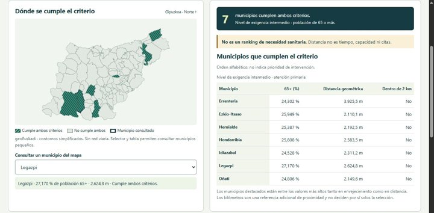

<h2> Oier Duñabeitia Berezo</h2>

**Ingeniería Informática · Software e IA aplicada**

  

<picture><source media="(prefers-reduced-motion: reduce) and (max-width: 600px)" srcset="assets/header-nodes-mobile-still.svg" /><source media="(prefers-reduced-motion: reduce)" srcset="assets/header-nodes-still.svg" /><source media="(max-width: 600px)" srcset="assets/header-nodes-mobile.gif" /></picture>

Estudio **Ingeniería Informática en Deusto** y he completado el Máster de IA de BIG School. Desarrollo webs, integraciones y automatizaciones sobre una base de lenguajes y bases de datos, ampliada mediante proyectos y aprendizaje autónomo. En **DeustoAI Labs** trabajo con datos públicos, geografía y calidad del software.

## GIPUZKOA 360

> **IA y datos públicos para explorar el acceso sanitario y la movilidad en Gipuzkoa.**
>
> Proyecto de DeustoAI Labs con **Asier Comba y Hugo Fernández Díez**. Mi contribución: ingesta oficial, análisis geoespacial, calidad, reproducibilidad e integración.
>
> **Top 3 entre más de 60 equipos**, según comunicación de la organización al equipo del Urban Challenge 2026.

[Repositorio](https://github.com/Asier-Comba/Guipuzkoa360) · [Demo pública](https://asier-comba.github.io/Guipuzkoa360/) · [Equipo y contribuciones](https://github.com/Asier-Comba/Guipuzkoa360/blob/main/docs/TEAM.md)

Captura real y alcance

88 municipios; fuentes Eustat, geoEuskadi y Open Data Euskadi. La demo muestra **resultados guardados y reproducibles**. Distancia geométrica, tiempos programados y escenarios no acreditan capacidad sanitaria ni citas disponibles.

Final presencial prevista: **17 de octubre de 2026**. Presentación prevista: **5 de noviembre**, City Science Summit, Tabakalera; información facilitada al equipo.

[Guía de demostración](https://github.com/Asier-Comba/Guipuzkoa360/blob/main/docs/DEMO.md) · [Hackathon](https://gipuzkoa-ai-hackathon.com/)

## Stack

Fundamentos académicos en lenguajes, tecnologías web y bases de datos; práctica y aprendizaje autónomo en los proyectos enlazados.

| Área | Tecnologías |
| :--- | :--- |
| **Lenguajes** |     Python · Java · C · C++ · JavaScript · TypeScript · SQL |
| **Web** |     HTML5 · CSS3 · React · Next.js · Tailwind CSS |
| **Bases de datos / backend** |    PostgreSQL · MySQL · Supabase · integración de APIs |
| **IA / flujos** |  Integración de modelos · agentes con herramientas · n8n · APIs de IA |
| **Desarrollo / entrega** |   Git · GitHub · pruebas · Vercel · VPS |

SQL es el lenguaje de consulta; PostgreSQL y MySQL son los gestores de bases de datos.

## Proyectos

Desarrollo propio y en colaboración; repositorios y autoría originales.

| Proyecto | Desarrollo y enlaces |
| :--- | :--- |
| **CRM** | **Inmobiliario con IA.** Prototipo: clientes, inmuebles, oportunidades, calendario y asistente. Integraciones según configuración. Next.js · TypeScript · Supabase · API de OpenAI · n8n [Ficha técnica](https://github.com/oierdu/oierdu/blob/main/crm-inmobiliario.md) |
| **Mateo Von Coach** | Web y plataforma de coaching: servicios, testimonios y reserva de llamadas. Desarrollo en colaboración. React · Vite · Tailwind CSS · Supabase [Web](https://mateovoncoach.com/) · [Código](https://github.com/Asier-Comba/Appweb-MateoVonCoach) |
| **Ahorra Aislando** | Web de aislamiento: servicios, estudio y contacto. Desarrollo en colaboración. React · Vite · Tailwind CSS · Framer Motion [Web](https://web-ahorraaislando.vercel.app/) · [Código](https://github.com/Asier-Comba/web-ahorraaislando) |
| **Ekin Zentro** | Web de entrenamiento, nutrición y bienestar en Lekeitio. [Web](https://www.ekinzentroa.com/) |
| **Activa Asesores** | Web de asesoría: servicios y contacto. [Web](https://proyecto-activa-asesores.vercel.app/) |
| **CRM Telecom** | Participación en un producto web colaborativo. **En desarrollo**; no se presenta como servicio lanzado. Next.js · TypeScript · Supabase [Repositorio público](https://github.com/Asier-Comba/CRM-Telecomunicaciones) |

## Cómo trabajo

En GIPUZKOA 360 preparo fuentes, valido contratos de datos y cuido la reproducibilidad. En web integro interfaz, datos y APIs, documento lo que está operativo y lo que requiere configuración.

## Contacto

Busco oportunidades de **desarrollo de software, backend e IA aplicada compatibles con mis estudios**.

[LinkedIn](https://www.linkedin.com/in/oier-du%C3%B1abeitia-a64804362/) · [oier.dunabeitia@opendeusto.es](mailto:oier.dunabeitia@opendeusto.es) · [GitHub](https://github.com/oierdu)
